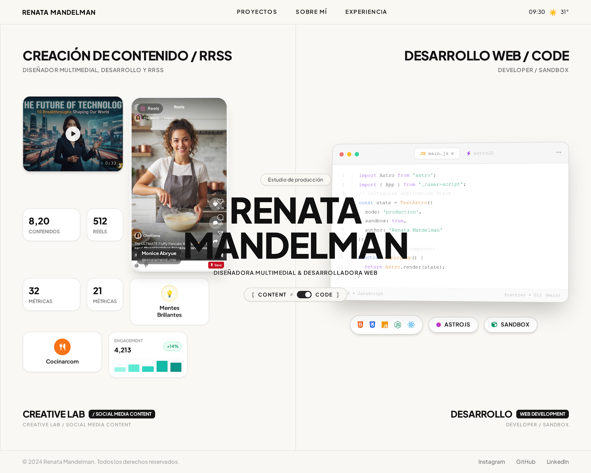

# Renata Mandelman — Portfolio "Split View"

Portfolio personal e interactivo para el Examen Final de **Programación Multimedial IV**.
Una pantalla dividida entre **Creación de Contenido / RRSS**, **Diseño** y **Desarrollo Web**: quien visita elige el modo de lectura con el toggle `[ CONTENT ⇄ DESIGN ⇄ CODE ]`.

**¿Para quién es?** 
Para las personas que me pueden contratar o convocar: marcas y agencias que buscan creadoras UGC, estudios de diseño y equipos de desarrollo web. Cada una puede ir directo a su área sin pasar por las otras, y al mismo tiempo ver que las tres conviven en mi trabajo.

🔗 **Deploy:** https://portfolio-mandelman-renata.vercel.app · 
📓 **Bitácora:** [más abajo](#bitácora)

## Instalación y ejecución

Requisitos: Node.js 22 o superior.

```bash
npm install        # instala dependencias
npm run dev        # servidor local en http://localhost:4321
npm run build      # genera el sitio estático en /dist
npm run preview    # sirve /dist localmente para probar el build
```

## Estructura

```
├── astro.config.mjs        # Config de Astro + Tailwind (plugin Vite)
├── README.md               # Documentación + bitácora de proceso
├── public/                 # Archivos estáticos (favicon, imágenes, videos)
└── src/
    ├── components/         # Componentes propios (ViewToggle, ProjectCard, DynamicApiWidget)
    ├── data/profile.ts     # Datos del CV (experiencias, stack)
    ├── layouts/            # BaseLayout (head/SEO) y SplitLayout (las tres columnas)
    ├── pages/index.astro   # Página principal
    └── styles/global.css   # Design tokens y estilos base
```

## Componentes propios

**`ViewToggle.astro`**: es el botón `[ CONTENT ⇄ DESIGN ⇄ CODE ]` y el foco del sitio. Cuando elegís una opción, guarda cuál es en `<html data-view>` y el CSS cambia la pantalla según eso. Lo hice con radios en vez de botones porque así ya funciona con teclado y con lectores de pantalla sin que yo tenga que programarlo. También se acuerda de la última vista que elegiste (con `localStorage`). Cuando entrás por primera vez no hay ninguna opción marcada y ves la portada con las tres columnas.

**`ProjectCard.astro`**: es la tarjeta de cada marca con la que trabajé como creadora de contenido. Al tocarla se abre un modal con lo que hice y los videos. Usé `<dialog>` porque ya trae el cierre con Esc y el manejo del foco. Los videos de TikTok se cargan recién cuando tocás play, para que la página no tarde más de lo necesario.

**`DynamicApiWidget.astro`**: trae mis proyectos de programación desde la API de GitHub. Muestra solo los repos que tienen el topic `portfolio`, así para sumar un proyecto nuevo no tengo que tocar el código. Mientras carga muestra un aviso, y si la API falla se siguen viendo los proyectos que tengo cargados a mano, con un botón para reintentar.

**`ProjectLink.astro`**: es el diseño de cada proyecto de la lista. Lo separé en un componente para que los proyectos que escribí yo y los que llegan de GitHub se vean exactamente iguales.

Además, los layouts tienen su propia lógica: `SplitLayout.astro` arma las tres columnas y decide cuál se agranda según la vista elegida (todo con CSS), y `BaseLayout.astro` carga la vista guardada antes de que se dibuje la página, para que no se vea un "salto" al entrar.

## Tecnologías y decisiones

**Astro** era obligatorio, pero además le queda bien a mi portfolio: casi todo el sitio es contenido que no cambia, así que Astro lo arma como HTML plano y la página carga rápido. El JavaScript lo usé solo donde hace falta: el toggle, los modales y el pedido a GitHub.

**Tailwind CSS (v4)** lo usé porque ya lo conocía y me deja maquetar rápido. No tiene archivo de configuración: mis colores, tipografías y espacios están definidos como *tokens* en `src/styles/global.css`, así si quiero cambiar un color lo cambio en un solo lugar. Para las partes más complejas, como las columnas que cambian según la vista, escribí CSS común dentro de cada componente porque se entiende mejor.

**Tipografías:** Inter para los textos y JetBrains Mono para el toggle y los detalles "de código", que remiten a la parte de programación. Las instalé con Fontsource para que se sirvan desde mi sitio y no dependan de Google Fonts.

**No usé React ni otro framework.** Las interacciones son simples y con TypeScript dentro de los `<script>` de Astro alcanzaba. Sumar un framework hubiera sido más código para explicar sin que la experiencia mejore.

Otras decisiones importantes:
- **Una sola fuente de verdad para la vista:** la vista elegida vive solo en `<html data-view>`. El toggle la escribe y el CSS la lee. Así no hay dos cosas que se puedan desincronizar.
- **Los datos separados del diseño:** mi experiencia, las marcas, los proyectos y los textos están en `src/data/profile.ts`. Los componentes reciben esos datos y los muestran, así para sumar algo no toco el HTML.
- **Elementos nativos primero:** radios para el toggle, `<dialog>` para los modales y `<button>` para todo lo que se toca. Ya vienen accesibles y me ahorran código.
- **Deploy en Vercel:** como el sitio es estático, Vercel detecta Astro solo y no tuve que configurar nada.

## API / fuente dinámica

Uso la **API pública de GitHub**, sin token:

```
GET https://api.github.com/users/renatamandelman/repos?per_page=100&sort=updated
```

**Qué información obtengo:** la lista de mis repositorios. De cada uno uso el nombre, la descripción, la URL del sitio publicado (el campo "Website") y los *topics*. Muestro solo los repos que tienen el topic `portfolio` y una URL publicada. Así, para sumar un proyecto al portfolio no toco el código: en GitHub le pongo el topic y el link de Vercel, y aparece solo.

**Cómo se integra:** los proyectos de Code salen de dos lugares. Algunos los cargué a mano en `profile.ts` y se ven siempre. Los de GitHub se suman al final de la misma lista, con la misma tarjeta (`ProjectLink`), así quien visita no nota la diferencia. Si un repo apunta a un sitio que ya está en la lista, no lo repito.

**Estados y qué pasa si algo falla:**
- **Cargando:** mientras espera la respuesta, debajo de la lista aparece "Cargando más proyectos…".
- **Con datos:** se agregan los proyectos y el aviso desaparece.
- **Sin proyectos nuevos (vacío):** si GitHub responde pero ningún repo tiene el topic, no muestro ningún error, porque los proyectos de `profile.ts` ya están. La lista nunca queda vacía.
- **Error:** distingo tres casos con mensajes distintos: sin conexión, límite de pedidos (GitHub responde 403) y cualquier otro error de GitHub. En los tres casos los proyectos fijos se siguen viendo y aparece un botón **"Reintentar"**.

**Límites:** sin token, GitHub permite **60 pedidos por hora por IP**. Para un portfolio alcanza, porque cada visita hace un solo pedido. Si se pasa, aviso que hay que probar en un rato. No usé token porque en un sitio estático quedaría visible en el código del navegador.

Los cambios de estado también se anuncian a lectores de pantalla (`aria-live`) y la lista se marca como "ocupada" mientras carga (`aria-busy`).

**Proyectos de diseño (Behance):** quise traerlos de Behance, pero su API pública está cerrada. Por eso los cargué en `profile.ts`, con las imágenes guardadas en `public/design/`, y cada tarjeta lleva a su proyecto en Behance.


## Responsive y accesibilidad

**Responsive.** No quise que en el celular el sitio fuera la versión de escritorio achicada, así que cambia la forma de recorrerlo:
- **Desktop (desde 1100px):** las tres columnas se ven una al lado de la otra. Al elegir una vista, esa columna se agranda y las otras dos quedan como rieles finitos que se pueden tocar para cambiar.
- **Mobile:** en la portada las columnas se apilan. Al elegir una vista se ve solo ese panel, y el toggle queda fijo arriba al scrollear para cambiar en cualquier momento. Al final de cada panel hay botones "Ver Design →", "Ver Code →", etc., para seguir sin volver arriba.
- Para que la imagen y los proyectos se acomoden lado a lado usé **container queries** (`@container`): dependen del ancho del panel, que cambia con el toggle, y no del ancho de la pantalla.
- Probé a 390px (celular): portada y las tres vistas.

**Accesibilidad.**
- **Elementos nativos:** el toggle son radios, los modales son `<dialog>` y todo lo que se toca es un `<button>` o un link. Así funciona con teclado (Tab, flechas, Esc) sin programarlo aparte.
- **Foco visible:** cuando navegás con teclado, todo lo que tiene foco muestra un borde oscuro.
- **Link "Saltar al contenido":** es lo primero que aparece al tocar Tab y lleva directo al contenido sin pasar por el header.
- **Imágenes:** las imágenes de los proyectos tienen `alt=""` a propósito, porque el link ya tiene el nombre del proyecto en texto y el lector lo diría dos veces. Los videos embebidos tienen un `title` con la marca y el nombre del video.

## Limitaciones y mejoras

Cosas que sé que todavía se pueden mejorar:
- **El toggle no se entiende del todo a primera vista.** En la portada no hay ninguna opción marcada y parece un subtítulo más que un botón. Quiero que las opciones se vean como botones y sumar una pista también en desktop.
- **Los proyectos de diseño se cargan a mano.** Como la API de Behance está cerrada, cada proyecto nuevo lo tengo que sumar en `profile.ts`.
- **Límite de GitHub.** Sin token son 60 pedidos por hora por IP. Si alguna vez no alcanza, la mejora sería traer los repos en el momento del build en vez de en el navegador.


## Créditos y uso de IA

- Tipografías: Inter y JetBrains Mono (SIL Open Font License), vía Fontsource.
- Uso de IA: ver [Bitácora → Uso de IA](#uso-de-ia).

---

## Bitácora

> Mi registro de cómo fui armando el portfolio: qué hice, por qué, qué probé y descarté, y qué me quedó pendiente.
> Lo voy escribiendo al terminar cada jornada.

### El problema que quiero resolver

Mi perfil tiene tres partes que en un CV quedan desconectadas: **creación de contenido / RRSS** , **Diseño** y **desarrollo web** .
La idea de "Split View" es que esa mezcla sea la *forma* del sitio y no solo un dato: la persona que entra elige desde qué lado leerme.

### Alternativas que pensé al principio

- **Portfolio de scroll único con secciones:** funciona, pero no muestra que mis áreas se mezclan; parece un CV largo.
- **Una página por área (/content, /design, /code):** rompe la idea de ver todo junto.
- **Pantalla dividida + toggle de modo de lectura** ✅ (la que elegí): la interacción principal cambia cómo se lee todo el sitio.

---

### Día 1 — 10/11

**De dónde arranqué**

Mi primer diseño tenía dos columnas, **Content | Code**, con mi nombre grande en el centro y un toggle de dos opciones. Todavía no existía la columna de Design (la sumé en los días 2 y 3).



**Qué hice**
- Armé el proyecto con Astro 7 + Tailwind v4 (como plugin de Vite) y fuentes autoalojadas (Inter y JetBrains Mono).
- Definí los colores y tipografías como tokens en `src/styles/global.css` con `@theme`.
- Hice `BaseLayout`, `SplitLayout` y mi primer componente: `ViewToggle`.
- Separé los datos del CV en `src/data/profile.ts`.

**Decisiones**
- La vista elegida se guarda en `<html data-view>`: es la única "fuente de verdad". El toggle la escribe y el CSS la lee.
- Usé **radios nativos** para el toggle en vez de botones con JS, porque ya son accesibles (Tab + flechas, y los lectores de pantalla los anuncian).
- En desktop, el panel que no está elegido no desaparece: queda como un **riel** vertical que se puede clickear.

**Problemas**
- A 390px el menú del header se partía en dos líneas y aparecía scroll horizontal. Lo resolví poniendo el header en columna en mobile y `whitespace-nowrap`.

---

### Días 2 y 3 — 11 y 12/11

**Qué hice**
- Hice `ProjectCard`: cada marca con la que trabajé es una tarjeta que abre un modal (`<dialog>`) con mis tareas y los videos.
- Sumé los videos UGC (TikTok, Instagram y videos locales). El reproductor de TikTok recién se carga al tocar play, para que la página no cargue cosas de más.
- El toggle pasó de 2 a 3 opciones: `[ CONTENT ⇄ DESIGN ⇄ CODE ]`, porque el diseño gráfico y UX/UI también es parte de lo que hago.
- _(completar: qué más hice y qué problemas tuve estos días)_

---

### Día 4 — 13/11

Fue el día de rediseñar la estructura. Probé varias versiones hasta encontrar una que me cerrara.

**Lo que probé y descarté**
1. **Nombre arriba y Design debajo.** Saqué mi nombre del centro y puse los proyectos de diseño abajo. Perdía fuerza: el nombre quedaba como un título más. 
2. **Nombre flotando encima de los proyectos de Design.** Quedaba tapando las imágenes y no se entendía.
3. Volví a la versión del principio (nombre en el centro de Content | Code, como en la captura del Día 1) mientras pensaba otra cosa. Pero ya no me servía: con Design tenía que haber tres columnas.
4. **Tres columnas con "muestras" de proyectos.** Cada columna mostraba algunos proyectos y un botón "Ver todo". Mezclaba la portada con las listas y se veía recargado.

**Lo que quedó**
- Me armé una maqueta en HTML con google Stitch como referencia: tres columnas iguales, **Content | Design | Code** (en el mismo orden que el toggle), con mi nombre y el toggle arriba al centro. La rehice con mis componentes y mis tokens.
- La pantalla de inicio es una **portada visual**: cada columna es una "imagen" (el celular con el reel, un frame tipo Figma con mi proyecto destacado y la paleta real del sitio, y el editor de código).
- Al tocar un botón, ese panel se agranda y aparecen **sus proyectos** al lado de la imagen. Los otros dos quedan como rieles.
- En mobile se ve un panel a la vez y se cambia con el toggle, que queda fijo arriba al scrollear.

**Cómo lo resolví en código**
- Agregué un cuarto estado, `data-view="all"`, para la portada. Al entrar, el toggle no tiene ninguna opción marcada (con radios nativos eso es válido) y se vuelve al inicio tocando mi nombre en el header.
- Los proyectos de cada panel tienen la clase `.more`, que solo se ve cuando ese panel está elegido. Todo depende de `data-view`, sin JS extra.
- El proyecto destacado de diseño se marca con `featured: true` en `profile.ts`, así no queda escrito a mano en el HTML.
- Para que la imagen y los proyectos se pongan lado a lado usé una **container query** (`@container`): el diseño depende del ancho del panel (que cambia con el toggle), no del de la pantalla.

**API de GitHub**
- Hice `DynamicApiWidget`: trae mis repos públicos de la API de GitHub y muestra los que tienen el topic `portfolio` y una URL de Vercel. Para sumar un proyecto no toco código: le pongo el topic en GitHub.
- Al principio los mostraba en una sección aparte "desde GitHub", pero para quien visita son todos mis proyectos, así que los junté en una sola lista con los de `profile.ts`. Si la API falla, los de `profile.ts` se siguen viendo, con un aviso y un botón "Reintentar".
- Hice `ProjectLink` para que las tarjetas fijas y las que llegan de la API usen el mismo markup (el widget la usa vacía como molde dentro de un `<template>`).
- Marqué 3 repos con el topic: castingFlow, Keipana Academy y UGC Gaia.

**Otras decisiones**
- **Proyectos de diseño:** los datos están en `profile.ts`, las imágenes locales en `public/design/` y cada tarjeta linkea a Behance. No usé base de datos porque no le suma nada a la propuesta, y no tomo las imágenes directo de Behance porque si cambian las URLs se rompen. Behance tampoco me sirve como API porque su API pública está cerrada.
- Moví la "Animación Gimnasio" de Content a **Design → Motion**: es una pieza de motion, no contenido para redes.
- Agregué un **"Sobre mí"** con el texto de mi CV. Lo probé debajo de mi nombre, pero en la portada no entraba, así que quedó debajo de las columnas.
- **Portada del reel:** quise sacar la miniatura de TikTok con su API (oEmbed), pero para este video no la devuelve, y además esas URLs vencen. Usé una captura mía guardada en `public/videos/`.

**Problemas**
- Después de poner imagen y proyectos lado a lado, **los proyectos de Design desaparecieron**. La lista tenía `@container` y `mx-auto` dentro de una grilla: `mx-auto` hace que el elemento tome el ancho de su contenido, pero un container no usa su contenido para calcular su ancho, así que quedaba en 0px. Lo arreglé con `w-full`. Aprendí que un `@container` necesita un ancho que le venga de afuera.

**Deploy**
- Subí el sitio a Vercel: https://portfolio-mandelman-renata.vercel.app. Como es estático, no tuve que configurar nada (Vercel detecta Astro solo). Después actualicé `site` en `astro.config.mjs` con la URL real.

**Pruebas de pantalla**
- [x] 390px: portada, Content, Design, Code
- [ ] 1440px: portada, Content, Design, Code
- [ ] Sitio publicado en el celular

**Pendiente**
- Los links "Proyectos" y "Experiencia" del header apuntan a partes que en la portada están ocultas.
- La foto del reel pesa 462 KB y se ve chiquita: achicarla.
- Completar las otras secciones de este README.

---

### Día 5 — 18/11

**Qué hice**
- Completé partes del README: a quién está dirigido el portfolio, los componentes propios y las tecnologías y decisiones.
- Ordené la bitácora: sumé la captura de mi primer diseño (dos columnas) en el Día 1 para que se vea de dónde arranqué.

**Decisiones**
- **Le cambié el nombre de "Dual View" a "Split View".** "Dual" venía de cuando eran dos áreas (Content y Code). Al sumar Design dejó de tener sentido. "Split View" describe lo que pasa en pantalla, que está dividida, y coincide con el nombre de mi layout, `SplitLayout`.

---

### Uso de IA

| Tarea | Herramienta | Qué decidí yo | Qué revisé / cambié / descarté |
| --- | --- | --- | --- |
| Estructura inicial, config y layout split | Claude | — | _completar: qué entendí, qué modifiqué_ |
| Rediseño a tres columnas, estado `all`, portada visual | Claude Code (en VS Code) | Las versiones que probé y descarté, la maqueta de referencia, que la portada sea solo imagen y que al tocar cada botón se vean los proyectos. | _completar_ |
| `DynamicApiWidget` y `ProjectLink` (API de GitHub) | Claude Code | Usar GitHub con topics en vez de cargar los proyectos a mano; qué repos mostrar; juntar todo en una sola lista. | _completar_ |
| Bug del `@container` en 0px | Claude Code | Lo detecté yo al ver que no aparecían los proyectos de Design. | _completar_ |
| Redacción de esta bitácora | Claude Code | Pedí que la fuera escribiendo a partir de lo que hacíamos; la reviso y la corrijo yo. | _completar_ |
